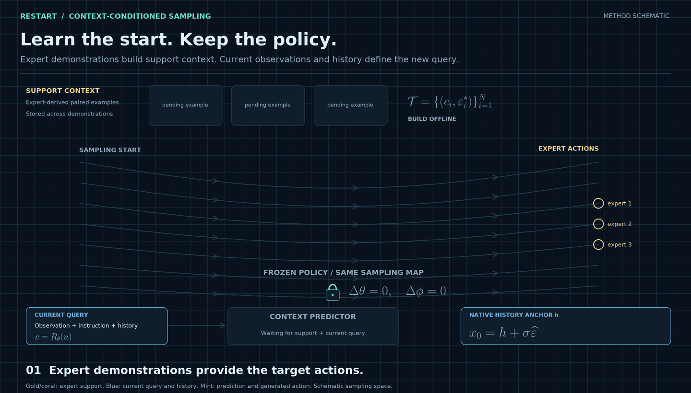
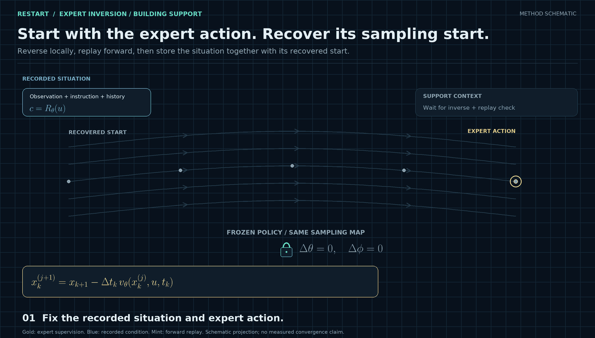
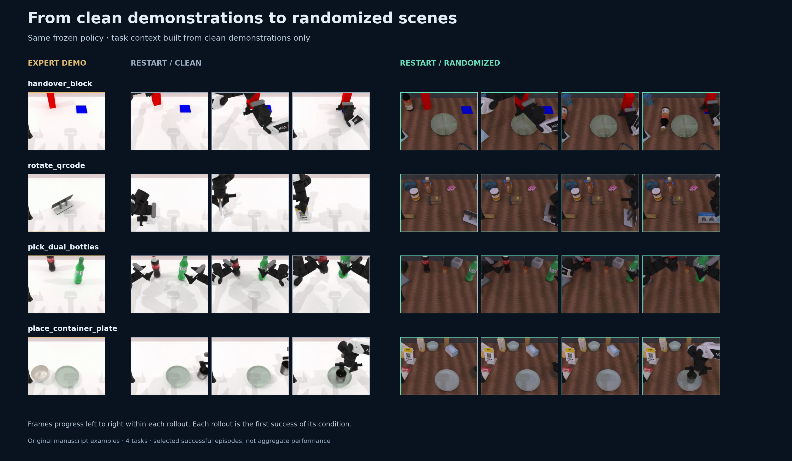
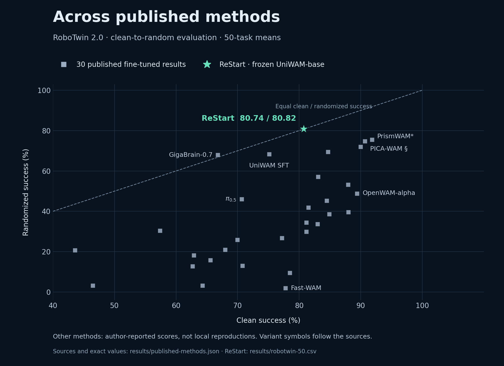
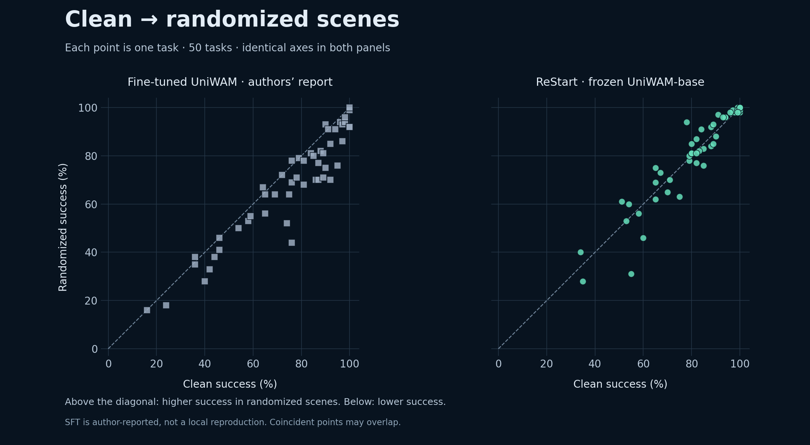
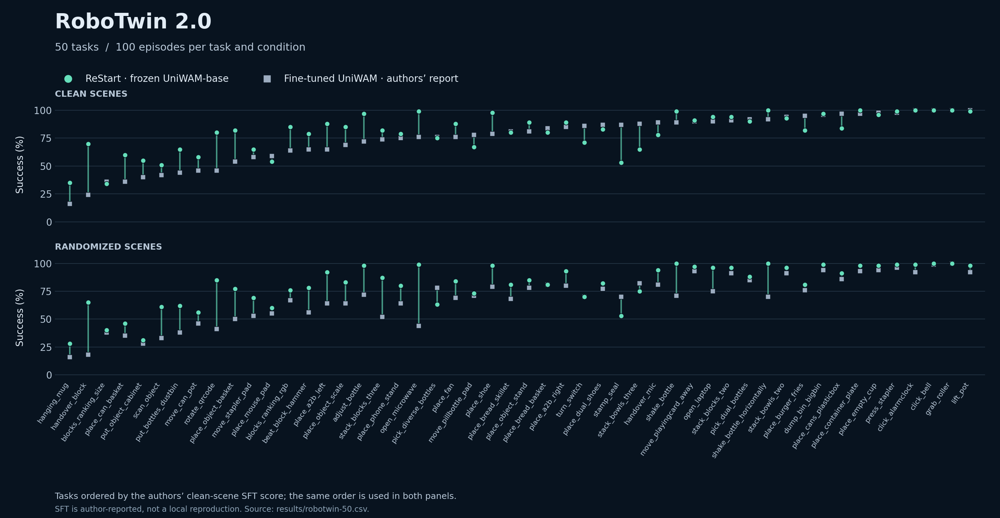
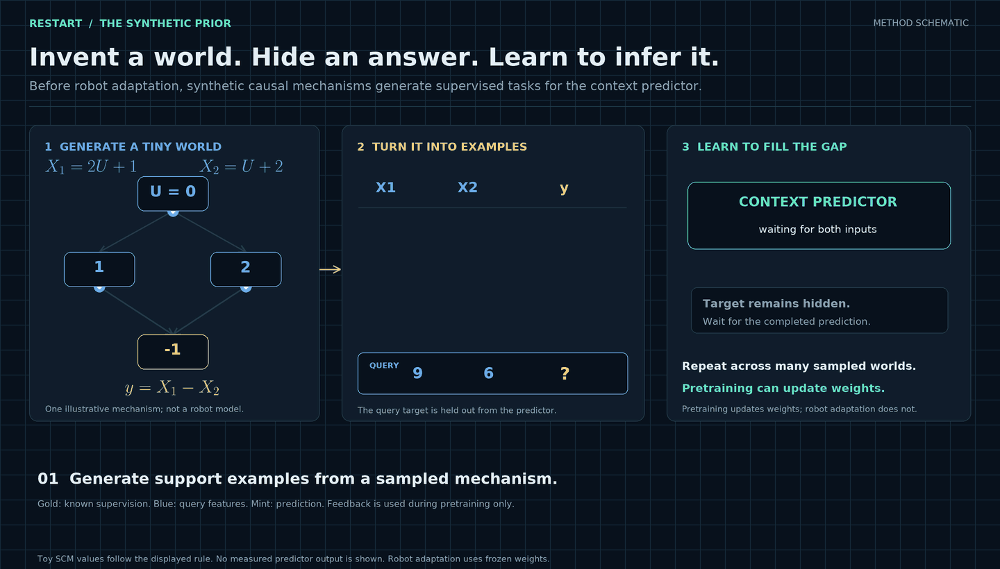

# ReStart

### Redirect, Don't Rewrite

**Adapt a frozen world-action model through its sampling start point.**

**Related project: [Inpriora](https://github.com/ai-for-data/inpriora)** — a pretrained tabular foundation model for in-context classification and regression.

[How it works](docs/method.md) · [Results](docs/results.md) · [Integration](docs/reproduction.md) · [Static illustrations](docs/assets/README.md)

ReStart turns expert demonstrations into an inference-time context. It inverts demonstrated actions into starting noise, predicts a start for the current situation, and lets the frozen policy generate the action through its existing sampling process.

## Context adaptation without policy updates

1. **Invert expert actions.** Recover starting points by stepwise inversion and verify them by forward replay.
2. **Build context.** Pair the current-condition representation with the admitted inverse noise at the native replanning times throughout expert trajectories.
3. **Predict and sample.** Query the fixed context predictor, combine its noise prediction with the policy's native history anchor, and run the original action sampler.

The frozen policy retains its action representation, history conditioning, and sampling schedule. ReStart changes the predicted noise component of its starting point.

## Demonstrations and rollout examples

The same four examples shown in the paper: one clean expert demonstration frame, followed by ReStart rollout frames in clean and randomized scenes. Frames progress left to right within each condition. Each rollout is the first successful episode of its condition; the policy weights stay frozen, and context comes only from clean demonstrations.

[Full-resolution figure](docs/assets/restart-rollout-examples.png) · [Vector layout](docs/assets/restart-rollout-examples.svg)

## Results on RoboTwin 2.0

The released Action-only evaluation covers **50 tasks × 2 conditions × 100 episodes**.

| Condition | ReStart | Authors' reported fine-tuned policy |
|---|---:|---:|
| Clean | 80.74% | 75.14% |
| Randomized | 80.82% | 68.32% |

The fine-tuned reference is taken from the authors' report, not a reproduction on our evaluation stack. See [per-task counts](results/robotwin-50.csv) and [comparison scope](docs/results.md). The separate frozen-Base control covers **19 tasks**; its findings do not establish a full-benchmark Base comparison.

### Comparison with published methods

Each point is a method or reported variant, averaged over 50 tasks. ReStart is evaluated on frozen UniWAM-base; the other 30 results are author-reported fine-tuned policies, not local reproductions. The dashed line marks equal clean and randomized success.

[Exact scores and sources](results/published-methods.json) · [Vector figure](results/robotwin-published-methods.svg). Published results follow the tables in [PICA-WAM](https://arxiv.org/html/2610.26813), [PrismWAM](https://arxiv.org/html/2610.26564), and [UniWAM](https://arxiv.org/html/2610.02054).

### Clean vs. randomized scenes

Each point is one task. Both panels use the same axes; the dashed diagonal marks equal clean and randomized success. [Vector figure](results/robotwin-clean-randomized-scatter.svg).

### Per-task results

The table reports exact ReStart successes out of 100 episodes and the authors’ reported SFT percentages for each task and condition.

Show all 50 task results

| Task | Clean ReStart | Clean SFT* | Randomized ReStart | Randomized SFT* |
|---|---:|---:|---:|---:|
| `adjust_bottle` | 97/100 | 72% | 98/100 | 72% |
| `beat_block_hammer` | 79/100 | 65% | 78/100 | 56% |
| `blocks_ranking_rgb` | 85/100 | 64% | 76/100 | 67% |
| `blocks_ranking_size` | 34/100 | 36% | 40/100 | 38% |
| `click_alarmclock` | 100/100 | 100% | 99/100 | 92% |
| `click_bell` | 100/100 | 100% | 100/100 | 99% |
| `dump_bin_bigbin` | 97/100 | 96% | 99/100 | 94% |
| `grab_roller` | 100/100 | 100% | 100/100 | 100% |
| `handover_block` | 70/100 | 24% | 65/100 | 18% |
| `handover_mic` | 78/100 | 89% | 94/100 | 81% |
| `hanging_mug` | 35/100 | 16% | 28/100 | 16% |
| `lift_pot` | 99/100 | 100% | 98/100 | 92% |
| `move_can_pot` | 58/100 | 46% | 56/100 | 46% |
| `move_pillbottle_pad` | 67/100 | 78% | 73/100 | 71% |
| `move_playingcard_away` | 91/100 | 90% | 97/100 | 93% |
| `move_stapler_pad` | 65/100 | 58% | 69/100 | 53% |
| `open_laptop` | 94/100 | 90% | 96/100 | 75% |
| `open_microwave` | 99/100 | 76% | 99/100 | 44% |
| `pick_diverse_bottles` | 75/100 | 76% | 63/100 | 78% |
| `pick_dual_bottles` | 90/100 | 92% | 88/100 | 85% |
| `place_a2b_left` | 88/100 | 65% | 92/100 | 64% |
| `place_a2b_right` | 89/100 | 85% | 93/100 | 80% |
| `place_bread_basket` | 80/100 | 84% | 81/100 | 81% |
| `place_bread_skillet` | 80/100 | 81% | 81/100 | 68% |
| `place_burger_fries` | 82/100 | 95% | 81/100 | 76% |
| `place_can_basket` | 60/100 | 36% | 46/100 | 35% |
| `place_cans_plasticbox` | 84/100 | 97% | 91/100 | 86% |
| `place_container_plate` | 100/100 | 97% | 98/100 | 93% |
| `place_dual_shoes` | 83/100 | 87% | 82/100 | 77% |
| `place_empty_cup` | 96/100 | 98% | 98/100 | 94% |
| `place_fan` | 88/100 | 76% | 84/100 | 69% |
| `place_mouse_pad` | 54/100 | 59% | 60/100 | 55% |
| `place_object_basket` | 82/100 | 54% | 77/100 | 50% |
| `place_object_scale` | 85/100 | 69% | 83/100 | 64% |
| `place_object_stand` | 89/100 | 81% | 85/100 | 78% |
| `place_phone_stand` | 79/100 | 75% | 80/100 | 64% |
| `place_shoe` | 98/100 | 79% | 98/100 | 79% |
| `press_stapler` | 99/100 | 98% | 99/100 | 96% |
| `put_bottles_dustbin` | 65/100 | 44% | 62/100 | 38% |
| `put_object_cabinet` | 55/100 | 40% | 31/100 | 28% |
| `rotate_qrcode` | 80/100 | 46% | 85/100 | 41% |
| `scan_object` | 51/100 | 42% | 61/100 | 33% |
| `shake_bottle` | 99/100 | 89% | 100/100 | 71% |
| `shake_bottle_horizontally` | 100/100 | 92% | 100/100 | 70% |
| `stack_blocks_three` | 82/100 | 74% | 87/100 | 52% |
| `stack_blocks_two` | 94/100 | 91% | 96/100 | 91% |
| `stack_bowls_three` | 65/100 | 88% | 75/100 | 82% |
| `stack_bowls_two` | 93/100 | 94% | 96/100 | 91% |
| `stamp_seal` | 53/100 | 87% | 53/100 | 70% |
| `turn_switch` | 71/100 | 86% | 70/100 | 70% |

*SFT values are author-reported results, not locally reproduced scores. See [scope and sources](docs/results.md).

[CSV data](results/robotwin-50.csv) · [Vector figure](results/robotwin-task-performance.svg)

## Learning to use a context

The context predictor is pretrained on synthetic supervised tasks. At robot adaptation time, it uses expert-derived examples without updating the policy's parameters.

These animations illustrate the method; they are not recorded robot rollouts or measured convergence traces.

## Code and reproduction

Start with the [integration guide](docs/reproduction.md). This repository contains the adaptation modules, native policy integration, support-library construction, result tables, and illustration source. External policy weights, robot assets, and the upstream simulator are obtained separately from their providers.

[Technical provenance](docs/credits.md) · [Source snapshots](upstream-sources.lock.json) · [Usage notice](NOTICE.md)
