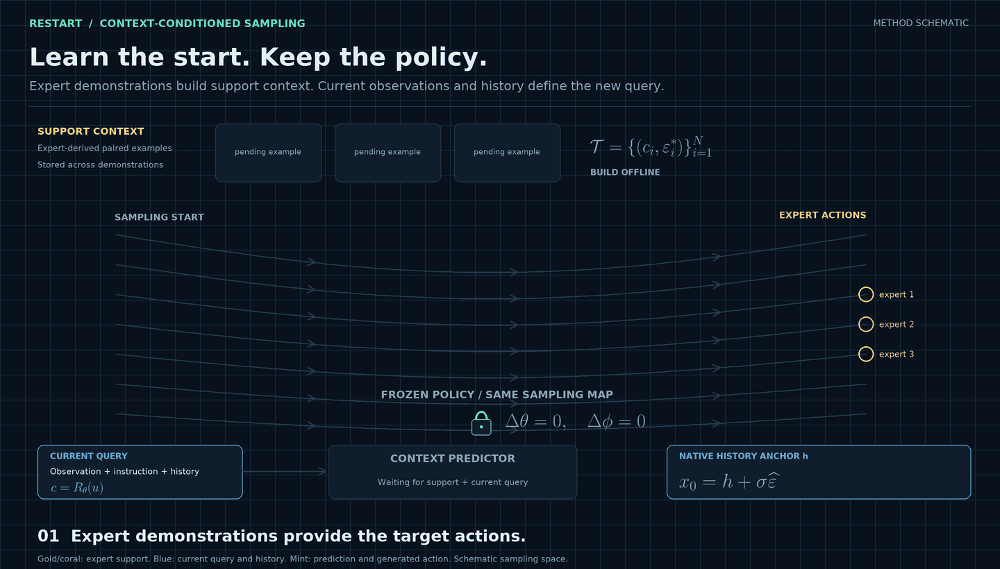
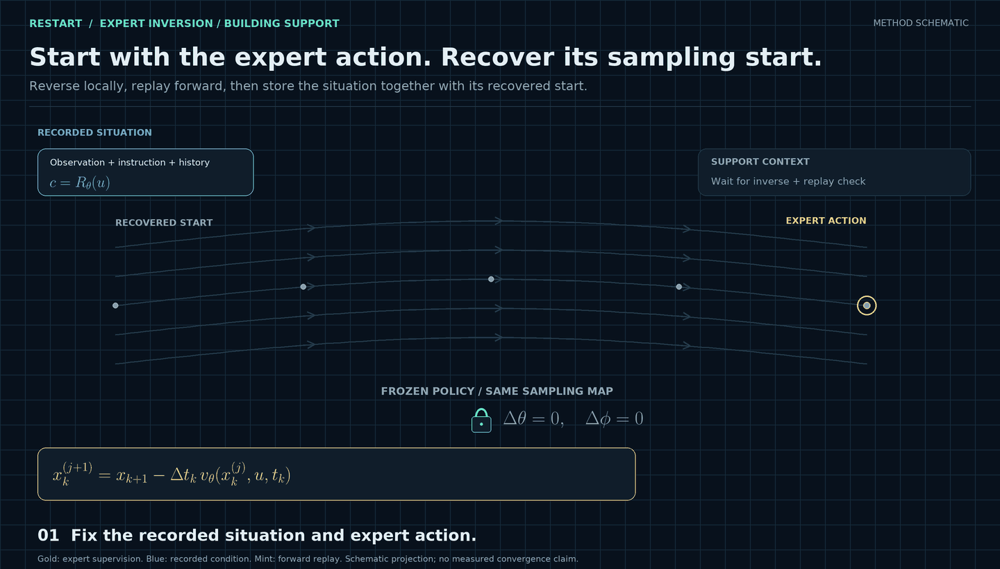
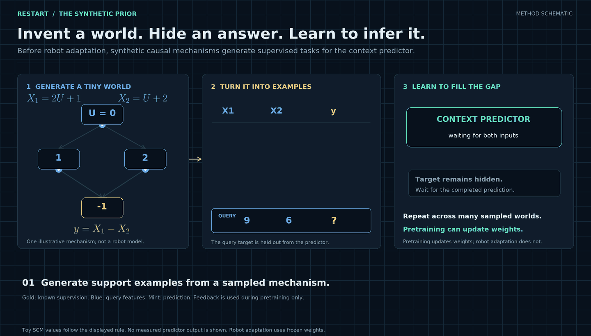

# The ReStart interface

ReStart composes a frozen robot policy and a frozen context predictor. Task information is supplied through examples, without task-specific weight updates.

## Context-conditioned action generation

The native condition $u$ is mapped to a fixed feature readout $c=R_\theta(u)$. Expert demonstrations supply the context:

$$
\mathcal T=\{(c_i,\varepsilon_i^*)\}_{i=1}^{N},
\qquad \widehat\varepsilon=F_\phi(c\mid\mathcal T).
$$

The predicted noise initializes the original action sampler:

$$
x_0=h+\sigma\widehat\varepsilon,
\qquad \widehat a=G_\theta(u,\widehat\varepsilon),
\qquad \Delta\theta=\Delta\phi=0.
$$

The history anchor, noise scale, action representation, and native execution path are preserved. The context uses expert-supervised examples; predictions are not silently recycled as expert labels.

## Offline inversion

At the policy's native replanning points, recover a starting point for each expert action chunk. For a native Euler step,

$$
x_{k+1}=x_k+\Delta t_k\,v_\theta(x_k,u,t_k),
$$

the local inverse uses reverse initialization followed by fixed-point corrections:

$$
x_k^{(j+1)}=x_{k+1}-\Delta t_k\,v_\theta(x_k^{(j)},u,t_k).
$$

Work backward from the expert action. Convert the recovered initial state to a noise label around the unchanged native history anchor:

$$
\varepsilon^*=\frac{x_0^*-h}{\sigma}.
$$

Check that label using the same forward sampler:

$$
r=\operatorname{MSE}\!\left(G_\theta(u,\varepsilon^*),a^*\right),
\qquad r\leq\tau\;\Longrightarrow\;(c,\varepsilon^*)\in\mathcal T.
$$

The explicit execution recipe determines the correction budget and admission threshold. Raw labels and residuals are retained, including rejected rows. This is approximate inversion; passing replay does not establish closed-loop success.

## Synthetic-prior pretraining

SCM means structural causal model. A synthetic prior samples graph functions, propagates random root vectors, and selects feature and target columns to create supervised table tasks:

$$
U\sim P_U,\qquad H_j=f_j(H_{\mathrm{pa}(j)}),
\qquad (X,y)=\operatorname{SelectColumns}(H).
$$

Pretraining learns a conditional prediction rule across these tasks. Robot adaptation subsequently reuses the fixed predictor with an expert-derived table. It does not fit a robot causal graph or rerun synthetic pretraining on demonstrations.

## Changing the context

Adding expert demonstrations adds their admitted inverted rows. The predictor's context is prepared again for the updated table, without parameter optimization. Each update need not improve every rollout; evaluate gains over the declared task set.

The animations illustrate processing order and dependencies. Their paths, table values, and local iterates are schematics, not measured attention, convergence traces, or additional robot experiments. Equations are compiled from TeX. [Rendering source and stills](assets/README.md) · [Technical attribution](credits.md).
